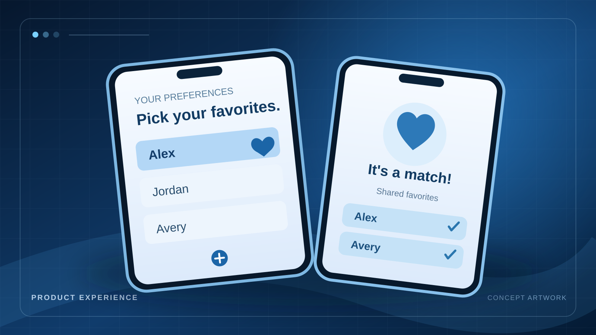
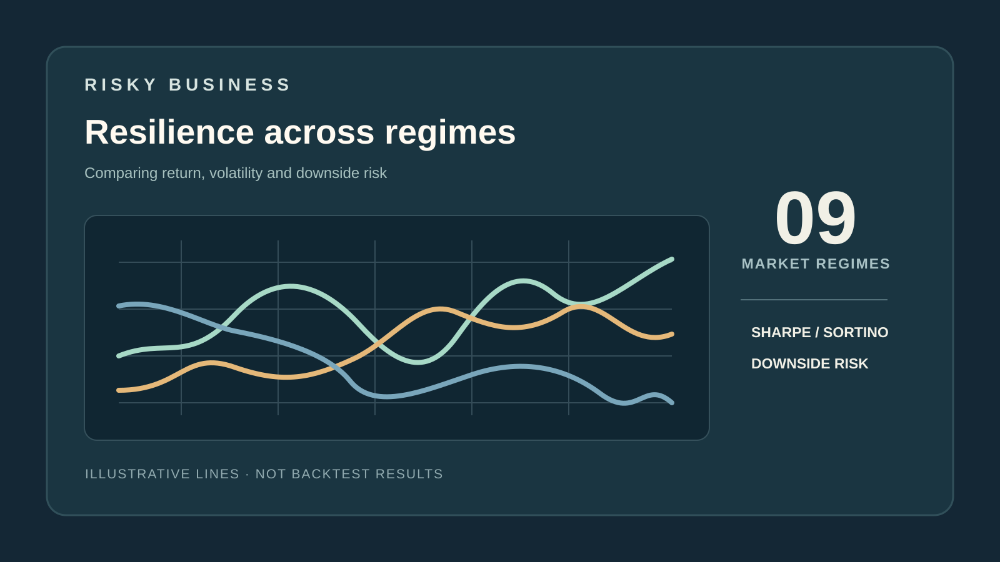
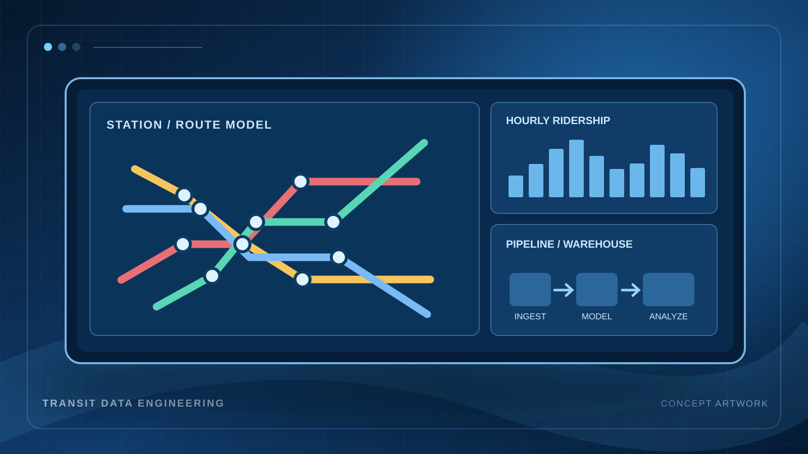

```{=html}
<div class="landing-page">
  <section class="landing-hero" aria-labelledby="home-name">
    <div class="landing-copy">
      <p class="eyebrow"><span class="eyebrow-rule" aria-hidden="true"></span> PRODUCT MANAGER · TECHNICAL BUILDER</p>
      <h1 id="home-name">Alexander Jackson<span class="name-period">.</span></h1>
      <p class="hero-lede">I turn complex problems into useful products.</p>
      <p class="hero-summary">My work connects product thinking with software, data, and business strategy. I like understanding the real problem, building a practical solution, and using evidence to make the next decision better.</p>
      <div class="hero-actions">
        <a class="btn btn-primary" href="projects.html">Explore my work <span aria-hidden="true">↗</span></a>
        <a class="btn btn-outline-primary" href="resume.pdf">Download résumé <span aria-hidden="true">↓</span></a>
      </div>
      <div class="hero-socials">
        <a href="https://github.com/awjackson00" target="_blank" rel="noopener noreferrer">GitHub ↗</a>
        <a href="https://www.linkedin.com/in/alexander-jackson5/" target="_blank" rel="noopener noreferrer">LinkedIn ↗</a>
        <a href="mailto:awjackson00@gmail.com">Email ↗</a>
      </div>
      <p class="hero-credentials">MBA <span>·</span> M.S. Data Science <span>·</span> B.A. Computer Science</p>
    </div>
    <div class="landing-photo">
      
    </div>
  </section>

  <section class="home-section" id="selected-work" aria-labelledby="work-heading">
    <div class="section-heading">
      <div>
        <p class="eyebrow">SELECTED WORK</p>
        <h2 id="work-heading">A closer look at what I've built.</h2>
        <p class="section-deck">From an independent application to a data warehouse and financial analysis, each project starts with a practical question.</p>
      </div>
      <a class="text-link" href="projects.html">All projects <span aria-hidden="true">↗</span></a>
    </div>
    <div class="feature-grid">
      <a class="feature-card" href="projects/pairname.html">
        <div class="feature-image"></div>
        <div class="feature-details"><span class="project-meta">01 / PRODUCT DEVELOPMENT</span><h3>PairName</h3><p>A baby-name matching app designed around independent choices and shared preferences.</p><span class="feature-link">Explore the case study ↗</span></div>
      </a>
      <a class="feature-card" href="projects/risky-business.html">
        <div class="feature-image"></div>
        <div class="feature-details"><span class="project-meta">02 / DATA SCIENCE</span><h3>Risky Business</h3><p>Exploring portfolio resilience and risk-adjusted performance across nine market regimes.</p><span class="feature-link">Explore the case study ↗</span></div>
      </a>
      <a class="feature-card" href="projects/prague-metro.html">
        <div class="feature-image"></div>
        <div class="feature-details"><span class="project-meta">03 / DATA ENGINEERING</span><h3>Prague Metro</h3><p>Building a path from transit events to analysis-ready models of line and hourly demand.</p><span class="feature-link">Explore the case study ↗</span></div>
      </a>
    </div>
    <p class="visual-disclosure">Project artwork is illustrative. The case studies explain the actual work and its scope.</p>
  </section>

  <section class="home-section expertise-section" aria-labelledby="approach-heading">
    <div class="section-heading">
      <div><p class="eyebrow">HOW I WORK</p><h2 id="approach-heading">Three perspectives. One product mindset.</h2></div>
    </div>
    <div class="expertise-grid">
      <div class="expertise-item"><span class="expertise-number">01 / PRODUCT</span><h3>Start with the problem</h3><p>Understand users and workflows, clarify requirements, and prioritize the right outcomes.</p></div>
      <div class="expertise-item"><span class="expertise-number">02 / TECHNICAL</span><h3>Understand the system</h3><p>Work comfortably with software, APIs, databases, and infrastructure, not just requirements documents.</p></div>
      <div class="expertise-item"><span class="expertise-number">03 / ANALYTICAL</span><h3>Use evidence to iterate</h3><p>Translate messy data into meaningful measures, clear tradeoffs, and better decisions.</p></div>
    </div>
  </section>

  <section class="home-section track-section" aria-labelledby="experience-heading">
    <div class="section-heading">
      <div><p class="eyebrow">PROFESSIONAL EXPERIENCE</p><h2 id="experience-heading">Hands-on work, across disciplines.</h2></div>
      <a class="text-link" href="experience.html">Full experience <span aria-hidden="true">↗</span></a>
    </div>
    <div class="experience-list">
      <div class="experience-line"><div><strong>Macfarlane Faletti &amp; Co</strong><small>Cloud &amp; database infrastructure</small></div><p>Helped improve systems serving 150+ weekly clients, reducing latency by approximately 20–30%.</p></div>
      <div class="experience-line"><div><strong>Marion Berries Baseball Club</strong><small>Project management &amp; growth operations</small></div><p>Coordinated inaugural-season marketing, stakeholders, and event workflows informed by engagement data.</p></div>
      <div class="experience-line"><div><strong>Willamette Angel Fund / Oregon Venture Fund</strong><small>Investment analysis &amp; product judgment</small></div><p>Evaluated early-stage companies through product, market, competitive, and financial due diligence.</p></div>
    </div>
  </section>

  <section class="home-closer" aria-labelledby="contact-heading">
    <p class="eyebrow">GET IN TOUCH</p>
    <h2 id="contact-heading">Let's make complex things useful.</h2>
    <p>I'm interested in Product Manager and Technical Product Manager opportunities where strong execution, technical depth, and good product decisions belong together.</p>
    <div class="hero-actions"><a href="mailto:awjackson00@gmail.com" class="btn btn-primary">Send an email ↗</a><a href="about.html" class="quiet-link">More about me ↗</a></div>
  </section>
</div>
```
