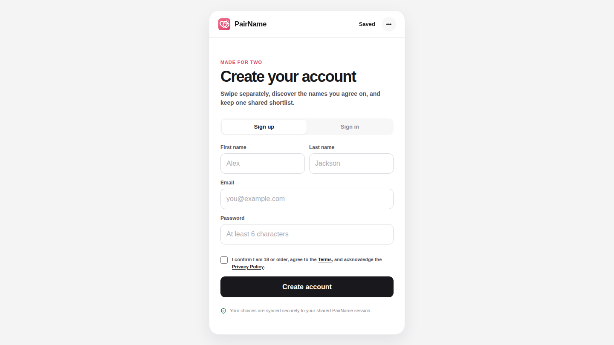
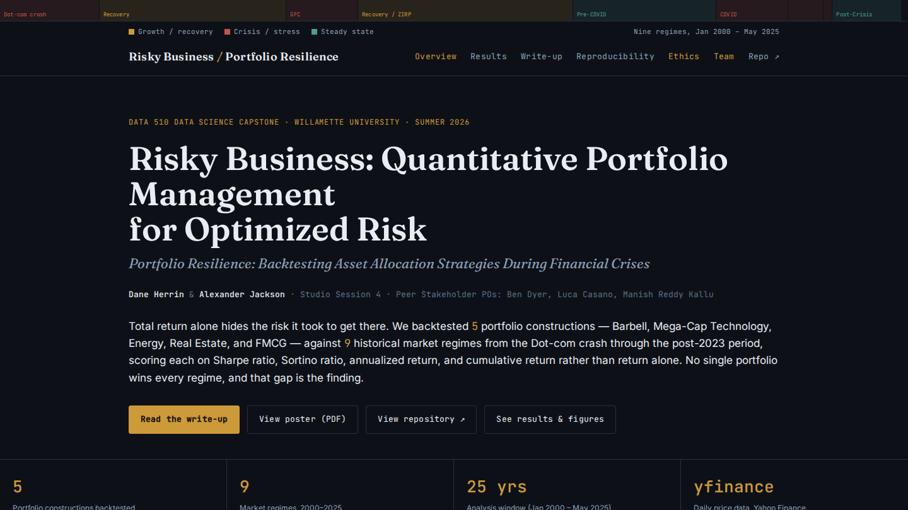
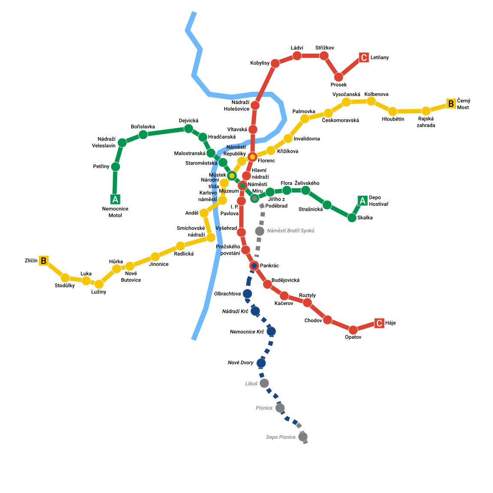
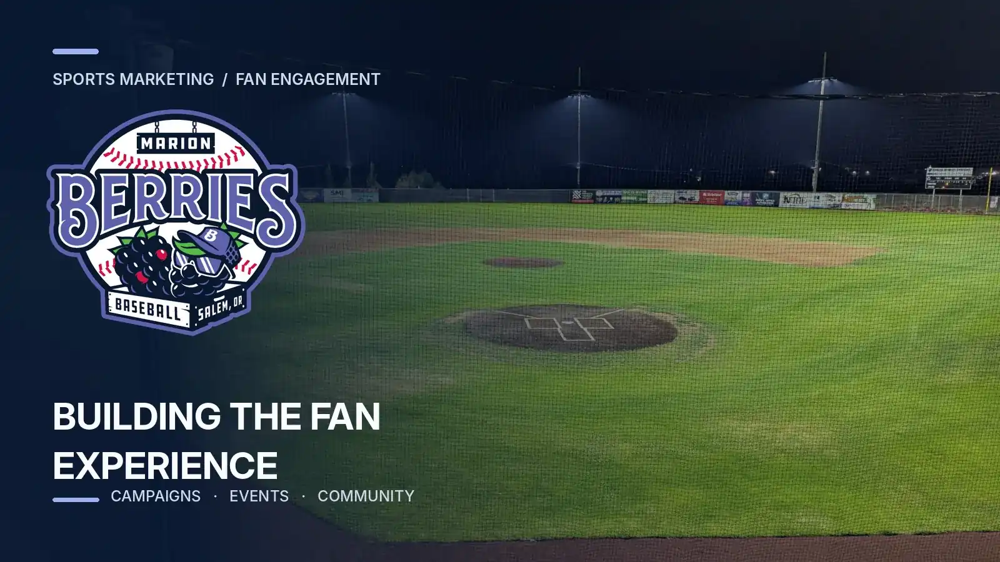
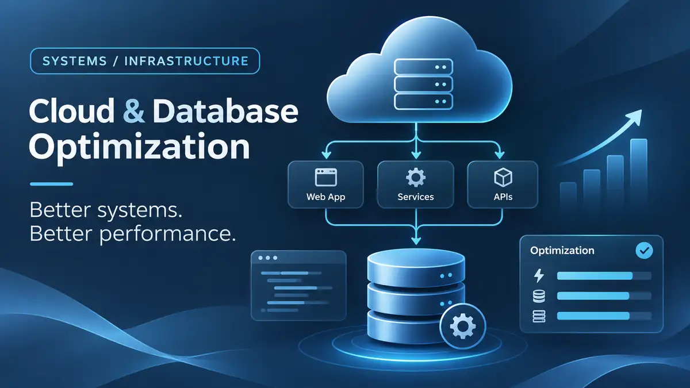

```{=html}
<div class="portfolio-intro">
  <p class="eyebrow">THE PORTFOLIO</p>
  <h2>Work worth opening up.</h2>
  <p>A working product, a collaborative financial study, data pipelines, marketing operations, and business-critical infrastructure. These case studies focus on the decisions behind the work and the results I can substantiate.</p>
</div>

<div class="filter-row" role="group" aria-label="Filter projects by discipline">
  <button type="button" class="filter-chip is-active" data-filter="All" aria-pressed="true">All work</button>
  <button type="button" class="filter-chip" data-filter="Product" aria-pressed="false">Product</button>
  <button type="button" class="filter-chip" data-filter="Engineering" aria-pressed="false">Engineering</button>
  <button type="button" class="filter-chip" data-filter="Data" aria-pressed="false">Data &amp; analytics</button>
  <button type="button" class="filter-chip" data-filter="Operations" aria-pressed="false">Operations</button>
</div>

<div class="portfolio-grid" id="portfolio-grid">
<article class="portfolio-card" data-tags="Product,Engineering">
  <a class="portfolio-cover" href="projects/pairname.html" aria-label="Read the PairName case study"></a>
  <div class="portfolio-copy">
    <div class="portfolio-topline"><span>PRODUCT DESIGN / APPLICATION DEVELOPMENT</span><span>01 / 05</span></div>
    <h2><a href="projects/pairname.html">PairName</a></h2>
    <p>Designed and built a mobile-first matching app where partners swipe privately, save their favorites, and discover names they both like.</p>
    <div class="portfolio-bottom"><span class="portfolio-proof">ZERO-TO-ONE PRODUCT</span><a href="https://pairname.awjackson00.workers.dev/" class="quiet-link" target="_blank" rel="noopener noreferrer" aria-label="Open PairName project website in a new tab">Try live app ↗</a><a href="projects/pairname.html" class="portfolio-arrow" aria-label="Read PairName case study">↗</a></div>
    <div class="portfolio-stack">JavaScript · Supabase · Authentication · UX flows</div>
  </div>
</article>
<article class="portfolio-card" data-tags="Data,Product">
  <a class="portfolio-cover" href="projects/risky-business.html" aria-label="Read the Risky Business case study"></a>
  <div class="portfolio-copy">
    <div class="portfolio-topline"><span>DATA SCIENCE / FINANCIAL ANALYTICS</span><span>02 / 05</span></div>
    <h2><a href="projects/risky-business.html">Risky Business</a></h2>
    <p>Co-developed a Python backtesting study comparing five portfolio strategies across nine market regimes using returns, volatility, Sharpe, and Sortino ratios.</p>
    <div class="portfolio-bottom"><span class="portfolio-proof">NINE MARKET REGIMES</span><a href="https://awjackson00.github.io/Risky-Business/" class="quiet-link" target="_blank" rel="noopener noreferrer" aria-label="Open Risky Business project website in a new tab">Visit website ↗</a><a href="projects/risky-business.html" class="portfolio-arrow" aria-label="Read Risky Business case study">↗</a></div>
    <div class="portfolio-stack">Python · pandas · NumPy · Statistical analysis</div>
  </div>
</article>
<article class="portfolio-card" data-tags="Engineering,Data">
  <a class="portfolio-cover" href="projects/prague-metro.html" aria-label="Read the Prague Metro case study"></a>
  <div class="portfolio-copy">
    <div class="portfolio-topline"><span>DATA ENGINEERING / TRANSIT ANALYTICS</span><span>03 / 05</span></div>
    <h2><a href="projects/prague-metro.html">Prague Metro data platform</a></h2>
    <p>Helped engineer a pipeline from transit events to PostgreSQL and dbt models, making station, route, and hourly ridership patterns queryable.</p>
    <div class="portfolio-bottom"><span class="portfolio-proof">PIPELINE → WAREHOUSE → DASHBOARD MART</span><a href="projects/prague-metro.html" class="portfolio-arrow" aria-label="Read Prague Metro case study">↗</a></div>
    <div class="portfolio-stack">Python · Airflow · AWS S3 · PostgreSQL · dbt</div>
    <div class="map-credit">2026 station map: <a href="https://commons.wikimedia.org/wiki/File:Prague_metro_plan_2026.svg" target="_blank" rel="noopener noreferrer">Tomáš Vojtíšek</a> · <a href="https://creativecommons.org/licenses/by-sa/4.0/" target="_blank" rel="noopener noreferrer">CC BY-SA 4.0</a></div>
  </div>
</article>
<article class="portfolio-card" data-tags="Operations,Product">
  <a class="portfolio-cover" href="projects/marion-berries.html" aria-label="Read the Marion Berries fan engagement case study"></a>
  <div class="portfolio-copy">
    <div class="portfolio-topline"><span>PROJECT MANAGEMENT / GROWTH</span><span>04 / 05</span></div>
    <h2><a href="projects/marion-berries.html">Marion Berries fan engagement</a></h2>
    <p>Managed marketing priorities and cross-team delivery for a baseball club's inaugural season, using fan engagement data to inform events and improve ticketing workflows.</p>
    <div class="portfolio-bottom"><span class="portfolio-proof">INAUGURAL SEASON</span><a href="projects/marion-berries.html" class="portfolio-arrow" aria-label="Read Marion Berries campaign case study">↗</a></div>
    <div class="portfolio-stack">Project management · Growth analytics · Stakeholders</div>
  </div>
</article>
<article class="portfolio-card" data-tags="Engineering,Operations">
  <a class="portfolio-cover" href="projects/infrastructure.html" aria-label="Read the Cloud & database optimization case study"></a>
  <div class="portfolio-copy">
    <div class="portfolio-topline"><span>SYSTEMS / INFRASTRUCTURE</span><span>05 / 05</span></div>
    <h2><a href="projects/infrastructure.html">Cloud & database optimization</a></h2>
    <p>Investigated cloud and database bottlenecks in systems serving 150+ weekly clients, helping reduce latency by roughly 20–30% and improve data-processing performance.</p>
    <div class="portfolio-bottom"><span class="portfolio-proof">20–30% LOWER LATENCY</span><a href="projects/infrastructure.html" class="portfolio-arrow" aria-label="Read Cloud & database optimization case study">↗</a></div>
    <div class="portfolio-stack">Databases · Cloud infrastructure · Performance</div>
  </div>
</article>
</div>
<p class="portfolio-endnote">Want to see the full analysis behind Risky Business? <a href="capstone.html">Read the capstone report ↗</a></p>

<script>
(function () {
  const filters = document.querySelectorAll('.filter-chip');
  const cards = document.querySelectorAll('.portfolio-card');
  function selectFilter(category) {
    filters.forEach((button) => {
      const active = button.getAttribute('data-filter') === category;
      button.classList.toggle('is-active', active);
      button.setAttribute('aria-pressed', String(active));
    });
    cards.forEach((card) => {
      const tags = (card.getAttribute('data-tags') || '').split(',');
      card.hidden = category !== 'All' && !tags.includes(category);
    });
  }
  filters.forEach((button) => button.addEventListener('click', () => selectFilter(button.getAttribute('data-filter'))));
  const param = new URLSearchParams(window.location.search).get('tag');
  if (param && Array.from(filters).some((el) => el.getAttribute('data-filter') === param)) selectFilter(param);
})();
</script>
```
