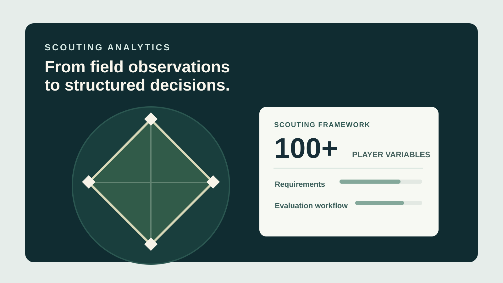

<a class="case-back" href="../projects.html">← Back to projects</a>
<header class="case-hero">
  
SOFTWARE DEVELOPMENT / LOS ANGELES DODGERS

  <h2>Scouting analytics platform</h2>
  
Making a complex scouting workflow easier to evaluate with consistent, data-informed tools.

  

MY ROLE<strong>Software developer</strong>

SCOPE<strong>100+ player variables and scout-informed workflows</strong>

TOOLS &amp; SKILLS<strong>Python, statistical modeling, requirements, iteration</strong>

</header>
<figure class="case-figure"><figcaption>Conceptual project illustration, not an actual product screenshot or performance chart.</figcaption></figure>

  <section>
01 / CONTEXT
<h3>The problem</h3>
Scouting requires making decisions from a broad range of player information. An effective tool needs to support the way scouts actually make decisions, not just present more statistics.
</section>
  <section>
02 / OWNERSHIP
<h3>What I contributed</h3>
I built a Python-based analytical tool and worked directly with scouts to understand their evaluation process, translate that process into requirements, and improve the system through feedback.
</section>
  <section>
03 / PROCESS
<h3>The approach</h3>
The work combined statistical modeling with product decisions about which information to surface and how to make analysis easier to use in a real workflow.
</section>
  <section>
04 / TAKEAWAY
<h3>Outcomes and learning</h3>
The project reduced manual analysis time by an estimated 15–20% and helped make evaluation workflows more consistent, as described in my project records.
</section>
  <section>
05 / WHAT'S NEXT
<h3>Where this goes next</h3>
Specific internal datasets and interfaces are not shown here. The cover image is a conceptual representation rather than an authentic team system screenshot.
</section>

<a class="quiet-link" href="../projects.html">Explore more projects ↗</a>

