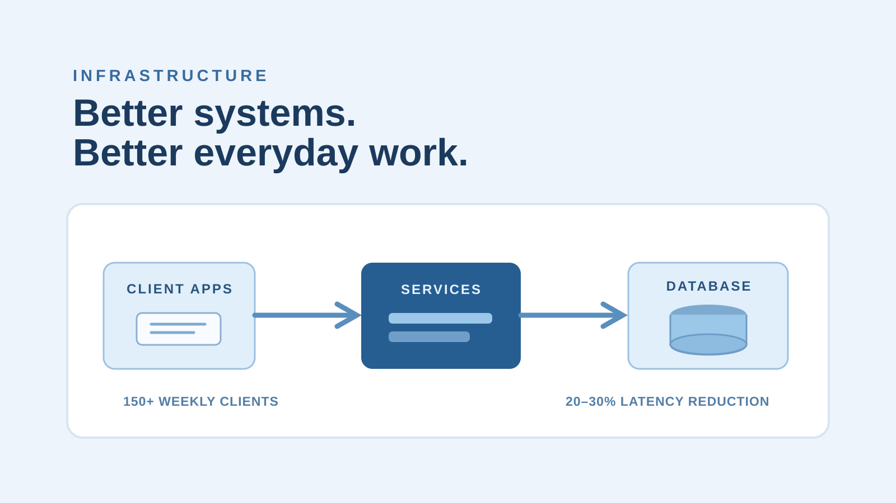

```{=html}
<div class="case-shell">
<a class="case-back" href="../projects.html">← Back to projects</a>
<header class="case-hero">
  <p class="eyebrow">INFRASTRUCTURE / MACFARLANE FALETTI & CO</p>
  <h2>Cloud &amp; database optimization</h2>
  <p class="case-lede">Making business-critical systems more responsive and reliable for the people using them every week.</p>
  <div class="case-meta"><div><span>MY ROLE</span><strong>Database manager and cloud administrator</strong></div><div><span>SCOPE</span><strong>Systems supporting 150+ weekly clients</strong></div><div><span>TOOLS &amp; SKILLS</span><strong>Databases, infrastructure, troubleshooting, requirements</strong></div></div>
<div class="case-link-strip"><a class="btn btn-primary case-external-link" href="https://www.mfco.com/" target="_blank" rel="noopener noreferrer">Visit company website ↗</a><span class="case-link-note">Organization website, not an internal system demo</span></div>
</header>
<figure class="case-figure"><figcaption>Conceptual project illustration, not an actual product screenshot or performance chart.</figcaption></figure>
<div class="case-content">
  <section><p class="eyebrow">01 / CONTEXT</p><h3>The problem</h3><p>Performance bottlenecks and legacy systems were increasing friction in everyday business workflows. Fixing the technical issues required understanding both system behavior and stakeholder needs.</p></section>
  <section><p class="eyebrow">02 / OWNERSHIP</p><h3>What I contributed</h3><p>I investigated bottlenecks, resolved infrastructure issues, worked with stakeholders on requirements, and contributed to modernization of existing database and cloud workflows.</p></section>
  <section><p class="eyebrow">03 / PROCESS</p><h3>The approach</h3><p>I prioritized reliability and measured improvements in latency and processing performance rather than only changes in technical architecture.</p></section>
  <section><p class="eyebrow">04 / TAKEAWAY</p><h3>Outcomes and learning</h3><p>The work reduced latency by roughly 20–30%, improved data-processing and access performance by approximately 25%, and resolved more than 22 infrastructure issues.</p></section>
  <section><p class="eyebrow">05 / WHAT'S NEXT</p><h3>Where this goes next</h3><p>The illustration depicts a generic architecture. It does not reveal client infrastructure, credentials, or internal systems.</p></section>
</div>
<div class="case-actions"><a class="btn btn-primary case-external-link" href="https://www.mfco.com/" target="_blank" rel="noopener noreferrer">Visit company website ↗</a><a class="quiet-link" href="../projects.html">Explore more projects ↗</a></div>
</div>
```
