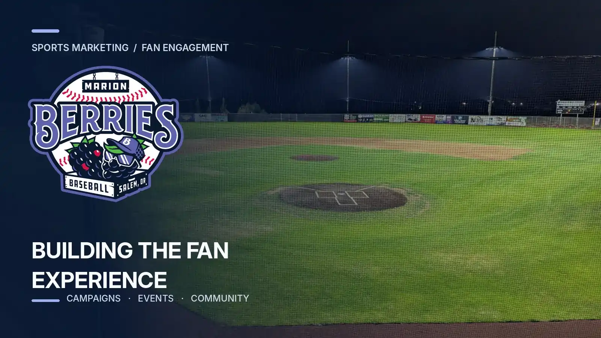

```{=html}
<div class="case-shell">
<a class="case-back" href="../projects.html">← Back to projects</a>
<header class="case-hero">
  <p class="eyebrow">PROJECT MANAGEMENT / GROWTH OPERATIONS</p>
  <h2>Marion Berries inaugural-season campaign</h2>
  <p class="case-lede">Coordinating marketing, game-day execution, and fan engagement as a new baseball club prepared for its first season.</p>
  <div class="case-meta"><div><span>MY ROLE</span><strong>Project manager, inaugural-season marketing</strong></div><div><span>SCOPE</span><strong>Campaign schedules, deliverables, stakeholders, events, and ticketing</strong></div><div><span>TOOLS &amp; SKILLS</span><strong>Project coordination, marketing analytics, operational improvement</strong></div></div>
</header>
<figure class="case-figure"></figure>
<div class="case-content">
  <section>
    <p class="eyebrow">01 / THE CHALLENGE</p>
    <h3>Launch a season while building the playbook</h3>
    <p>An inaugural season combines fixed game dates with changing marketing needs, event logistics, and cross-functional dependencies. The challenge was keeping work moving while giving stakeholders a clear view of priorities and deadlines.</p>
  </section>
  <section>
    <p class="eyebrow">02 / MY CONTRIBUTION</p>
    <h3>Keeping the campaign coordinated</h3>
    <p>As project manager for the inaugural-season marketing campaign, I helped organize schedules, deliverables, stakeholder check-ins, and dependencies across marketing and event operations. I used fan engagement information to inform outreach and event decisions, rather than relying on assumptions alone.</p>
  </section>
  <section>
    <p class="eyebrow">03 / EXECUTION</p>
    <h3>Connecting audience signals to operations</h3>
    <p>I tracked campaign work against milestones, supported coordination around game-day needs, and identified friction in ticketing and event workflows. The work balanced outward-facing fan engagement with the operational details needed to deliver it.</p>
  </section>
  <section>
    <p class="eyebrow">04 / THE RESULT</p>
    <h3>More efficient event and ticketing workflows</h3>
    <p>The improvements were associated with an estimated <strong>15% reduction in ticketing and event processing inefficiencies</strong>. That figure reflects the project's reported process improvement, not a claim about attendance growth or ticket revenue.</p>
  </section>
  <section>
    <p class="eyebrow">05 / THE TAKEAWAY</p>
    <h3>Execution is part of the fan experience</h3>
    <p>This project strengthened my ability to translate broad campaign goals into ownership, milestones, and measurable workflow improvements. A strong fan experience depends on coordinated operations as much as marketing ideas.</p>
  </section>
</div>
<div class="case-actions"><a class="quiet-link" href="../projects.html">Explore more projects ↗</a></div>
</div>
```
