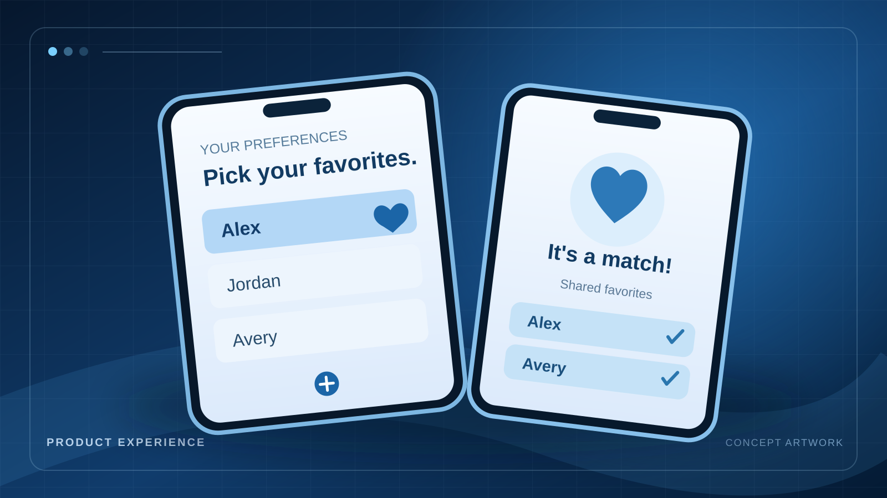

<a class="case-back" href="../projects.html">← Back to projects</a>
<header class="case-hero">
  
PRODUCT DEVELOPMENT / INDEPENDENT PROJECT

  <h2>PairName</h2>
  
Helping two partners discover the names they agree on, without letting one person's choices bias the other.

  

MY ROLE<strong>Product design and implementation</strong>

SCOPE<strong>Authentication, pairing, swipe flows, mutual matching, saved preferences</strong>

TOOLS &amp; SKILLS<strong>HTML, CSS, JavaScript, Supabase</strong>

</header>
<figure class="case-figure"><figcaption>Conceptual project illustration, not an actual product screenshot or performance chart.</figcaption></figure>

  <section>
01 / CONTEXT
<h3>The problem</h3>
Choosing a baby name is collaborative, but most lists make it hard to evaluate preferences independently. The opportunity was to help each person explore names freely and make overlap easy to discover.
</section>
  <section>
02 / OWNERSHIP
<h3>What I contributed</h3>
I developed the application flow from the initial concept through working functionality: partner pairing codes, authentication, likes, passes, Super Likes, undo, persistent preferences, realtime matching, and the saved-name views.
</section>
  <section>
03 / PROCESS
<h3>The approach</h3>
The central design decision was independent evaluation before surfacing mutual matches. That shaped the pairing flow, name review rules, and edge cases for restoring or prioritizing previously reviewed names.
</section>
  <section>
04 / TAKEAWAY
<h3>Outcomes and learning</h3>
The result is a working mobile-first product with application logic and Supabase-backed data. This is an independent product project; I am not claiming public adoption, revenue, or external customer outcomes.
</section>
  <section>
05 / WHAT'S NEXT
<h3>Where this goes next</h3>
A useful next step is to validate usability with pairs, measure where people drop out of onboarding, and improve the matching experience based on observed behavior.
</section>

<a class="quiet-link" href="../projects.html">Explore more projects ↗</a>

