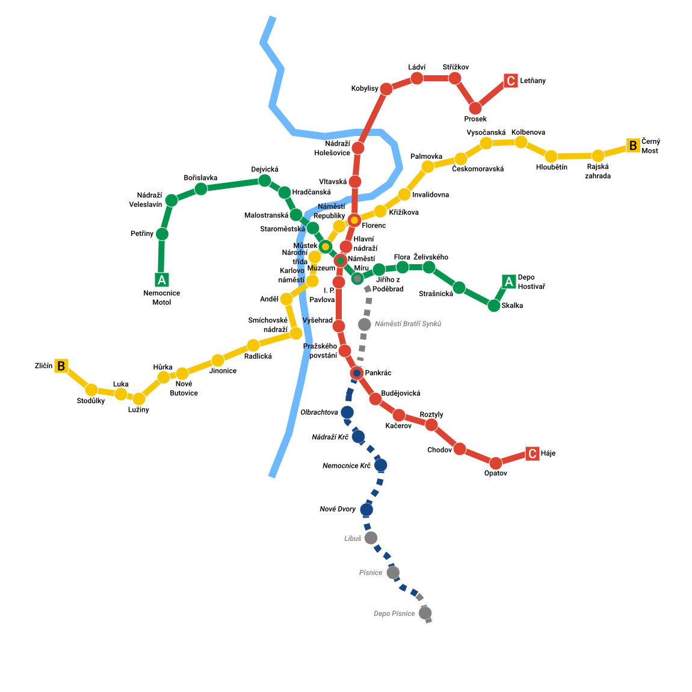

```{=html}
<div class="case-shell">
<a class="case-back" href="../projects.html">← Back to projects</a>
<header class="case-hero">
  <p class="eyebrow">DATA ENGINEERING / TRANSIT ANALYTICS</p>
  <h2>Prague Metro data platform</h2>
  <p class="case-lede">A data engineering project that turns fragmented transit events into models for analyzing demand by station, metro line, and hour.</p>
  <div class="case-meta">
    <div><span>MY ROLE</span><strong>Pipeline, warehouse, and analytical modeling</strong></div>
    <div><span>PROJECT SCOPE</span><strong>Transit events, station and route dimensions, line-hour demand</strong></div>
    <div><span>TOOLS &amp; SKILLS</span><strong>Python, Airflow, AWS S3, PostgreSQL, dbt, Docker</strong></div>
  </div>
</header>
<figure class="case-figure case-figure--metro-map">
  
  
</figure>
<div class="case-content">
  <section>
    <p class="eyebrow">01 / THE QUESTION</p>
    <h3>Which lines are busiest, and when?</h3>
    <p>Answering a straightforward ridership question requires much more than a chart. Event records, station metadata, and line connections have to agree before demand can be compared reliably across the Prague Metro network.</p>
  </section>
  <section>
    <p class="eyebrow">02 / MY CONTRIBUTION</p>
    <h3>Building the analytical foundation</h3>
    <p>I worked on a pipeline that used Python and Airflow for ingestion and orchestration, AWS S3 for structured snapshots, and PostgreSQL for storage. dbt transformations shaped the raw records into reusable warehouse models. The wider project also involved Docker, DuckDB, and MongoDB.</p>
  </section>
  <section>
    <p class="eyebrow">03 / THE HARD PART</p>
    <h3>Getting shared stations right</h3>
    <p>A station can serve multiple metro lines, which makes naive aggregation misleading. The warehouse used station and route dimensions, a station-to-line bridge, and allocated-tap logic to distribute demand across connected lines. A line-hour mart then made downstream comparisons easier to query.</p>
  </section>
  <section>
    <p class="eyebrow">04 / VALIDATED OUTPUT</p>
    <h3>An analysis-ready warehouse, not just a diagram</h3>
    <p>One validated build on June 12, 2026 included <strong>4 lines, 65 stations, 70 station-line relationships, 24 hourly buckets, approximately 1.4 million fact rows, and 933 line-hour mart rows</strong>. Those are figures from a recorded project run, not live ridership totals.</p>
  </section>
  <section>
    <p class="eyebrow">05 / THE TAKEAWAY</p>
    <h3>Trustworthy analytics starts with data modeling</h3>
    <p>This work connected a practical question to ingestion, orchestration, relationship modeling, and validation. The most important outcome was a data structure that could answer the question consistently, even at shared stations and across multiple time periods.</p>
  </section>
</div>
<div class="case-actions"><a class="quiet-link" href="../projects.html">Explore more projects ↗</a></div>
<div class="case-attribution"><span>MAP SOURCE</span> <a href="https://commons.wikimedia.org/wiki/File:Prague_metro_plan_2026.svg" target="_blank" rel="noopener noreferrer">Tomáš Vojtíšek</a> (based on Bilykralik16), <a href="https://creativecommons.org/licenses/by-sa/4.0/" target="_blank" rel="noopener noreferrer">CC BY-SA 4.0</a>. Original 2026 map used unmodified.</div>
</div>
```
