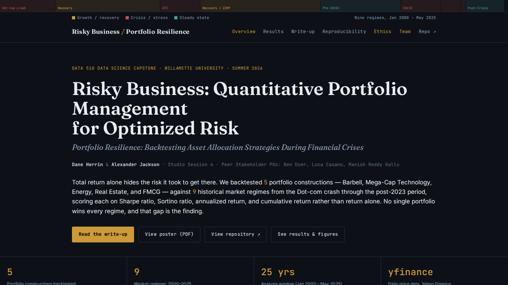

```{=html}
<div class="case-shell">
<a class="case-back" href="../projects.html">← Back to projects</a>
<header class="case-hero">
  <p class="eyebrow">DATA SCIENCE / WILLAMETTE UNIVERSITY</p>
  <h2>Risky Business</h2>
  <p class="case-lede">A jointly developed financial analysis that tests an important question: do strategies that win in good markets still hold up when conditions turn?</p>
  <div class="case-meta"><div><span>MY ROLE</span><strong>EDA, statistical modeling preparation, analysis, and technical writing; collaborative project</strong></div><div><span>SCOPE</span><strong>Five portfolio constructions across nine market regimes</strong></div><div><span>TOOLS &amp; SKILLS</span><strong>Python, pandas, NumPy, yfinance, ARIMA</strong></div></div>
</header>
<figure class="case-figure"></figure>
<div class="case-content">
  <section>
    <p class="eyebrow">01 / THE QUESTION</p>
    <h3>Is high return the same as resilience?</h3>
    <p>A strategy can produce strong long-run returns and still suffer severe losses when inflation, rates, or market volatility change. Dane Herrin and I examined five portfolio constructions across nine market regimes to compare not only performance, but the risks behind it.</p>
  </section>
  <section>
    <p class="eyebrow">02 / MY CONTRIBUTION</p>
    <h3>Preparing the evidence behind the findings</h3>
    <p>As a co-developer, I owned major parts of the exploratory data analysis workflow, data preparation, statistical-modeling setup, and technical writing. I helped turn historical prices into comparable portfolio return series and explain the results in terms useful to nontechnical decision-makers.</p>
  </section>
  <section>
    <p class="eyebrow">03 / THE METHOD</p>
    <h3>Compare portfolios across different kinds of stress</h3>
    <p>We used Python, pandas, NumPy, and yfinance to build return series and evaluate annualized returns, volatility, cumulative performance, and Sharpe and Sortino ratios. Market-regime comparisons revealed tradeoffs hidden by single-period results. We also tested ARIMA as a forecasting baseline rather than assuming it would predict returns.</p>
  </section>
  <section>
    <p class="eyebrow">04 / THE FINDINGS</p>
    <h3>No strategy wins in every regime</h3>
    <p>No portfolio consistently outperformed across all nine environments. In the 2022 rate-cycle period, the Energy portfolio returned 39.60% annualized while Mega-Cap Technology returned -46.35% annualized. ARIMA found little stable predictive structure in the daily return series. The result was a stronger case for scenario-aware risk evaluation, not a claim of a universal winning strategy.</p>
  </section>
  <section>
    <p class="eyebrow">05 / THE TAKEAWAY</p>
    <h3>Better decisions need more than one metric</h3>
    <p>The capstone demonstrates how to prepare defensible financial comparisons, acknowledge modeling limits, and communicate quantitative findings clearly. Historical performance is not a forecast, and the study is educational rather than investment advice.</p>
  </section>
</div>
<div class="case-actions"><a class="btn btn-primary" href="https://awjackson00.github.io/Risky-Business/" target="_blank" rel="noopener noreferrer">Visit Risky Business website ↗</a><a class="btn btn-outline-primary" href="https://awjackson00.github.io/Risky-Business/results.html" target="_blank" rel="noopener noreferrer">View results &amp; figures ↗</a><a class="btn btn-outline-primary" href="../capstone.html">Read full capstone ↗</a>
<a class="btn btn-outline-primary" href="https://github.com/awjackson00/data510--Quant-Back-Testing-" target="_blank" rel="noopener noreferrer">View public repository ↗</a><a class="quiet-link" href="../projects.html">Explore more projects ↗</a></div>
</div>
```
