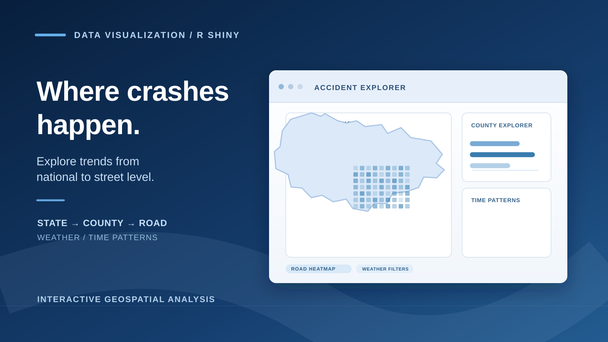

```{=html}
<div class="case-shell traffic-case">
<a class="case-back" href="../projects.html">← Back to projects</a>
<header class="case-hero">
  <p class="eyebrow">INTERACTIVE DATA VISUALIZATION / PUBLIC SAFETY</p>
  <h2>U.S. Traffic Accident Dashboard</h2>
  <p class="case-lede">An interactive R Shiny dashboard designed to help transportation planners explore where reported crashes cluster, when they occur, and how conditions change the picture.</p>
  <div class="case-meta traffic-facts" aria-label="Project overview">
    <div class="traffic-fact">
      <span class="traffic-fact-label">COLLABORATORS</span>
      <strong>Alexander Jackson<br>Simon Thompson</strong>
      <small>Joint visualization project</small>
    </div>
    <div class="traffic-fact">
      <span class="traffic-fact-label">DATASET</span>
      <strong>U.S. Accidents</strong>
      <small>Kaggle · 2016–2023</small>
    </div>
    <div class="traffic-fact">
      <span class="traffic-fact-label">TECHNOLOGY</span>
      <strong>R Shiny · Leaflet · Plotly</strong>
      <small>tidyverse · ggplot2 · sf · tidycensus</small>
    </div>
  </div>
  <div class="traffic-demo-action">
    <a class="btn btn-primary traffic-demo-button" href="https://ajackson25.shinyapps.io/USA_Accidents/" target="_blank" rel="noopener noreferrer">Explore the interactive dashboard <span aria-hidden="true">↗</span></a>
    <span class="traffic-demo-note">Opens the original Shiny app in a new tab</span>
  </div>
</header>
<figure class="case-figure">
  
</figure>
<div class="case-content">
  <section>
    <p class="eyebrow">01 / THE QUESTION</p>
    <h3>Where should road-safety teams look first?</h3>
    <p>Crash records can reveal concentrations that are easy to miss when analysis stays at the national or state level. We designed the project for transportation departments, city engineers, and public-safety stakeholders who need to identify potentially high-risk areas before deciding which corridors deserve deeper investigation.</p>
  </section>
  <section>
    <p class="eyebrow">02 / THE EXPERIENCE</p>
    <h3>Start nationally, then investigate a specific road</h3>
    <p>The dashboard's four views supported a progressive drill-down: a clickable U.S. state overview; county-level choropleth maps and ranked bar charts; a road-density heatmap based on latitude and longitude; and a day-of-week by hour-of-day analysis. Users could change states, narrow road views to a county, and filter by time of day or weather conditions.</p>
  </section>
  <section>
    <p class="eyebrow">03 / THE ANALYSIS</p>
    <h3>Compare locations more carefully</h3>
    <p>We worked with reported U.S. accident records covering 2016–2023 and introduced population-adjusted state and county comparisons using Census estimates. Weather observations were grouped into clearer categories, while time variables made patterns across hours and weekdays easier to explore. The comparisons were descriptive, not a claim that weather or time caused individual crashes.</p>
  </section>
  <section>
    <p class="eyebrow">04 / THE ENGINEERING</p>
    <h3>Keeping interactive maps responsive</h3>
    <p>Exploring millions of geolocated records created performance and deployment challenges. Our iterations included precomputed RDS summaries and map geometries, state-specific point files, cached summaries, and limits on how many crash markers the road heatmap rendered at once. We also worked on updating heatmap layers without repeatedly resetting the user's map position.</p>
  </section>
  <section>
    <p class="eyebrow">05 / THE TAKEAWAY</p>
    <h3>Better questions before better interventions</h3>
    <p>Working from national context down to county and street-level views made the data more useful for forming specific safety questions. Historical accident records are not a complete census of crashes and cannot, by themselves, establish the effectiveness of an intervention. Per-capita comparisons also use population estimates against a multi-year record set rather than annualized crash rates. The result was a collaborative exercise in thoughtful interactive analysis, geospatial data preparation, and user-centered decision support.</p>
  </section>
</div>
<div class="case-actions">
  <a class="btn btn-primary" href="https://ajackson25.shinyapps.io/USA_Accidents/" target="_blank" rel="noopener noreferrer">Open original Shiny dashboard ↗</a>
  <a class="quiet-link" href="../projects.html">Explore more projects ↗</a>
</div>
</div>
```
